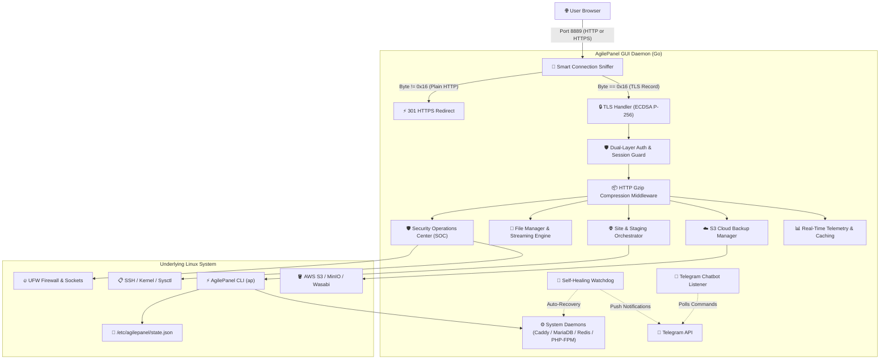

# 👑 AgilePanel GUI — Interactive Web Dashboard & Security Operations Center

<p align="center">
  <a href="https://github.com/webtechj/agilepanel-gui/releases"></a>
  <a href="https://github.com/webtechj/agilepanel-gui/tree/development"></a>
  
  
  
  
  
  <a href="LICENSE"></a>
</p>

<p align="center">
  <b>A lightweight, ultra-fast, glassmorphic server management dashboard and Security Operations Center (SOC) companion for the <a href="https://github.com/webtechj/agilepanel">AgilePanel (ap)</a> Linux orchestration CLI.</b>
</p>

<p align="center">
  <a href="#-latest-developments--release-highlights">🔥 Latest Developments</a> •
  <a href="#-system-architecture">🏗️ Architecture</a> •
  <a href="#-feature-showcase">⚡ Features</a> •
  <a href="#-installation--service-management">📥 Installation</a> •
  <a href="#-security-operations-center-soc">🛡️ Security Center</a> •
  <a href="#-autonomous-watchdog--telegram-chatbot">🤖 Telegram Bot</a> •
  <a href="#-cli-command-reference">💻 CLI Reference</a>
</p>

---

## 🌟 Overview

**AgilePanel GUI** is a standalone, compiled Go web daemon running on port `8889`. It delivers real-time system performance telemetry, automated security auditing, full-featured web file browsing, enterprise backup orchestration, and multi-site provisioning via a responsive, dark-mode glassmorphic browser interface.

Under the hood, AgilePanel GUI acts as an optimized, secure companion to the compiled `ap` CLI. Every action triggered within the dashboard faithfully mirrors operations executed over SSH, maintaining full synchronization with `/etc/agilepanel/state.json` without introducing third-party runtime bloat.

> [!TIP]
> **Zero Dependencies**: AgilePanel GUI compiles into a single, self-contained binary with all HTML, CSS, JavaScript, and assets embedded directly into the executable via Go `embed.FS`.

---

## 🔥 Latest Developments & Release Highlights

AgilePanel GUI has evolved from a simple monitoring dashboard into a full-scale **Security Operations Center (SOC)** and self-healing system guardian. Here are the latest developments:

```
┌─────────────────────────────────────────────────────────────────────────────┐
│                        🚀 RECENT RELEASE MILESTONES                         │
├──────────────┬──────────────────────────────────────────────────────────────┤
│ v1.1.7       │ 🌐 Modernized Dashboard Glance, Websites UI/UX Overhaul,     │
│ (Latest)     │    Zero-Downtime Multi-PHP Switcher, Sleek Management Cards  │
├──────────────┼──────────────────────────────────────────────────────────────┤
│ v1.1.6       │ 🖼️ File Manager Lightbox Image Preview, Authenticated Blob   │
│              │    Streaming, MIME Types, Session CSRF Subresource Protection│
├──────────────┼──────────────────────────────────────────────────────────────┤
│ v1.1.5       │ ⚡ Simplified System Load Display, Services Redesign,         │
│              │    Tools & Server Tuning Suite, Diagnostics & Hardening      │
├──────────────┼──────────────────────────────────────────────────────────────┤
│ v1.1.3       │ 🛡️ Security Operations Center (SOC), UFW Firewall Manager,   │
│              │    Structured Audit Logs, Active Sessions Guard, SSL Check   │
├──────────────┼──────────────────────────────────────────────────────────────┤
│ v1.1.2       │ 🔒 Automated Zero-Dependency ECDSA SSL/TLS, Single-Port      │
│              │    HTTP/HTTPS Multiplexer (port 8889), Dashboard Redesign    │
├──────────────┼──────────────────────────────────────────────────────────────┤
│ v1.1.1       │ 📁 High-Performance File Manager, Batch Delete, Chmod Matrix,│
│              │    Lightbox, Gzip Middleware, Streamed Direct-to-Disk Upload │
├──────────────┼──────────────────────────────────────────────────────────────┤
│ v1.1.0       │ 🤖 Self-Healing Watchdog Daemon, Interactive Telegram Bot,   │
│              │    Historical Resource Graph Filters, S3 Backup Orchestrator │
└──────────────┴──────────────────────────────────────────────────────────────┘
```

### 🌐 What's New in v1.1.7 — Dashboard Glance, Websites UI/UX Overhaul & Zero-Downtime PHP Switcher
* **Dashboard Glance Modernization**: Upgraded the primary system overview with modern glowing metric cards, cleaner layout hierarchy, and instant high-level status indicators.
* **Websites Page Overhaul**: Transformed the websites management view with dedicated quick filters (search by domain, filter by SSL or PHP version), real-time site counters, and copyable domain URLs.
* **Zero-Downtime Per-Site PHP Switcher**: Integrated seamless switching between installed PHP versions (PHP 8.1, 8.2, 8.3, etc.) directly inside the site Manage modal with live validation and zero service interruption.
* **Streamlined Websites Table & Modals**: Added read-only status badges for PHP versions directly in the websites table, simplified action buttons, and decoupled file management workflows directly into the dedicated File Manager.
* **Hardened Action API Handlers**: Extended backend action endpoints (`/api/websites/php-version`) with security validations and synchronized state updates.

### 🖼️ What's New in v1.1.6 — File Manager Image Lightbox & Subresource Delivery Hardening
* **Authenticated Image Lightbox**: Re-engineered File Manager image preview to stream files via authenticated `fetch()` directly into memory Object URLs (`blob:`), resolving subresource authorization and cookie handling.
* **Loading & Visual Error States**: Added loading spinner, visual error feedback on decode failures, live image dimension discovery (`naturalWidth x naturalHeight`), formatted byte size, and client-side instant file downloading.
* **Subresource Session Security**: Updated `sessionAuth` middleware to allow authenticated session reads (`GET`/`HEAD`) on media subresources and direct downloads without false CSRF rejection while maintaining strict double-submit token verification on all mutating requests (`POST`/`PUT`/`DELETE`).
* **MIME Streaming & Path Normalization**: Registered standard image MIME types (`.webp`, `.avif`, `.svg`, `.ico`, `.bmp`) on the Go backend and fixed path normalization so leading-slash paths safely resolve inside domain webroots without filesystem boundary escape.
* **Filename Encoding**: Hardened table row click handlers with URI component encoding, eliminating script injection or quote-break errors with filenames containing spaces or punctuation.

### ⚡ What's New in v1.1.5 — System Load Simplification & Server Tuning Suite
* **Simplified System Load Display**: Re-engineered system load gauge and indicators to present clear, color-coded workload health (Optimal, Normal, Heavy, Critical) with core-normalized metrics, eliminating raw load average ambiguity.
* **Services Page UI/UX Redesign**: Revamped service command center with modern glassmorphic cards, real-time memory/CPU usage per daemon, instant status badges, and 1-click restart/reload controls.
* **Server Diagnostics & Tuning Suite ("Tools & Tuning")**:
  * **Server Doctor**: Automated health and configuration diagnostics verifying daemon integrity, swap configuration, and essential system boundaries.
  * **Outbound Cloud Reachability Tester**: Live diagnostic test verifying connectivity to critical endpoints (DNS, package mirrors, WordPress.org, Cloudflare, GitHub).
  * **Zero-Downtime Cache & Memory Flusher**: Instant clearing of Redis object cache and PHP OPcache bytecode cache.
  * **Global Database Optimizer**: One-click table check and optimization across all MariaDB schemas.
* **Repository & Release Cleanliness**: Full decoupling of development-only artifacts (`graphify-out/`, mock state backups, test logs) from Git tracking, backed by a comprehensive `.gitignore`.

### 🛡️ What's New in v1.1.3 — Security Operations Center (SOC)
* **Automated Security Audit & Grading Engine**: Analyzes 15+ vital server security vectors across Network, Access, Web, and System configurations, scoring VPS health from `A+` to `D` with one-click automated remediation.
* **Integrated UFW Firewall Manager**: Monitor real-time firewall status, inspect incoming/outgoing rules, view active listening sockets, and dynamically allow or block custom ports/subnets directly from the UI.
* **Structured Security Audit Logs**: Live streaming of audit records (authentication attempts, firewall rules, file mutations, backups, service restarts) with severity level filtering and JSON/CSV export.
* **Active Sessions Guard**: Track all active authenticated sessions with IP geolocation info, User-Agent identification, creation/expiry timestamps, and remote 1-click session revocation.
* **SSL/TLS Certificate Inspector**: Live certificate inspection displaying subject, issuer, validity period, SANs (Subject Alternative Names), and an automated expiration countdown timer.

### 🔒 What's New in v1.1.2 — Automated SSL/TLS & Smart Multiplexing
* **Zero-Touch ECDSA P-256 SSL/TLS**: Automatically generates self-signed certificates on initial startup using pure Go cryptography—zero OpenSSL or certbot prerequisites. Includes automatic SAN inclusion for server IP, hostname, and localhost.
* **Single-Port HTTP/HTTPS Sniffer**: A custom connection multiplexer on port `8889` that inspects the first byte of incoming TCP traffic. Plain HTTP requests receive an instant `301 Moved Permanently` redirect to HTTPS, while TLS connections are served seamlessly on the same port!

### 📁 What's New in v1.1.1 — High-Performance File Manager & Optimizations
* **Batch Operations & Safety Boundaries**: Multi-select bulk deletions with strict webroot boundary checks to prevent accidental system file modifications.
* **Visual Chmod Matrix**: Interactive permission editor with a live octal calculator and strict permission validation.
* **Streamed Multipart Uploads**: Upload large files directly to disk via `MultipartReader`, keeping daemon memory usage at flat baseline levels even during gigabyte-scale transfers.
* **Full-Screen Code Editor**: Built-in dark syntax editor with font-size scaling and word-wrap toggle.
* **Zero-Fork Resource Optimization**: Implemented HTTP gzip compression middleware, 5-minute database size caching, and 15-second TTL service status caches to eliminate fork storms on VPS CPUs during idle polling.

---

## 🏗️ System Architecture

AgilePanel GUI is architected with defense-in-depth principles and high-throughput micro-caching:



---

## ⚡ Feature Showcase

| Module | Key Capabilities |
| :--- | :--- |
| 📊 **Glassmorphic Telemetry** | Real-time SVG circular gauges for CPU, RAM, Disk, and Swap. Historical charts with `Live`, `Today`, and `This Week` filters. Automatic 2-hour metric logging. |
| 🛡️ **Security Operations Center** | Comprehensive 15+ point security audit (SSH hardening, Fail2ban, UFW, DB exposure, TLS). Letter grading (`A+` to `D`). One-click remediation. |
| 🔥 **UFW Firewall Command Center** | Real-time firewall status, custom port allow/deny rules, listening socket table, and instant policy enforcement. |
| 🔒 **Automated SSL/TLS** | Pure Go ECDSA P-256 certificate generator. Dual-protocol port multiplexer (HTTP auto-redirect to HTTPS on port `8889`). |
| 📁 **Web File Manager** | File tree navigation, breadcrumbs, search, multi-file batch deletion, visual chmod matrix, image lightbox, copy/duplicate, and zip/unzip. |
| 📝 **Integrated Code Editor** | Full-screen code editor with syntax themes, word-wrap toggle, and customizable font scaling. |
| 🤖 **Watchdog & Telegram Bot** | Self-healing daemon that auto-restarts failed services (Caddy, MariaDB, Redis, PHP-FPM). Interactive Telegram chatbot (`/status`, `/sites`). |
| 🌐 **Site Orchestrator** | Deploy WordPress, WooCommerce, Laravel, Static HTML, or generic PHP sites. Toggle staging mode locking. Edit database credentials. |
| ☁️ **Enterprise Backups** | Local snapshot retention (protected 2-version limit) and offsite AWS S3 Cloud Object Storage uploads & instant restores. |
| ⚙️ **Services Command Center** | One-click start, stop, or restart for core web daemons with 15-second TTL status caching. |
| 🔧 **Tools & Server Tuning** | Zero-downtime Redis & OPcache flush, global database table optimizer, Server Doctor diagnostics, outbound cloud reachability tester, and web admin credentials manager. |
| 📺 **Simulated Stream Terminal** | Live browser terminal streaming background execution logs, stdout, and script warnings. |

---

## 🛡️ Security Operations Center (SOC)

The built-in **Security Operations Center (SOC)** provides enterprise-grade visibility and hardening for your VPS:

```
┌────────────────────────────────────────────────────────────────────────┐
│ 🛡️ AGILEPANEL SECURITY AUDIT REPORT                      GRADE: A+     │
├────────────────────────────────────────────────────────────────────────┤
│  🟢 UFW Firewall Policy         Enforced & Default Deny Incoming       │
│  🟢 SSH Root Login              Disabled (PermitRootLogin no)          │
│  🟢 SSH Password Auth           Disabled (Key-Based Authentication)    │
│  🟢 SSH Non-Standard Port       Active on Custom Port                  │
│  🟢 Fail2ban Intrusion Defense  Active with SSH & Nginx Jails          │
│  🟢 Database Port Exposure      Protected (127.0.0.1 Localhost Only)   │
│  🟢 AgilePanel GUI SSL/TLS      Enforced (ECDSA P-256 Dual Mux)        │
│  🟢 Caddy Web Server            TLS 1.3 & HTTP/3 Enabled               │
│  🟢 Unattended Security Updates Active & Scheduled Daily               │
└────────────────────────────────────────────────────────────────────────┘
```

### 1. Interactive UFW Firewall Manager
Configure server access rules without touching SSH:
* **Real-time Status**: View whether UFW is active and enforcing default policies.
* **Rule Table**: Inspect incoming and outgoing rules, action types (`ALLOW`, `DENY`), protocols (`TCP`, `UDP`), and target ports.
* **Dynamic Rule Provisioning**: Add custom port rules with a single click.
* **Listening Socket Monitor**: Inspect open TCP/UDP sockets to verify that internal services (like MariaDB port `3306`) are strictly bound to localhost.

### 2. Live Security Audit Log Stream
All sensitive actions are recorded with structured metadata:
* **Event Data**: Timestamp, Client IP, Action Identifier, Message Details, and Severity (`SUCCESS`, `INFO`, `WARNING`, `ERROR`).
* **Filtering & Search**: Instantly filter logs by severity level or query specific keywords.
* **Exporting**: One-click download of audit history in structured JSON or CSV format.

### 3. Active Sessions Guard & Revocation
Protect your dashboard against unauthorized session hijacking:
* View all active administrator sessions with client IP, browser User-Agent, and session age.
* Remotely revoke any session with instant token invalidation.
* Automatic background garbage collection sweeps expired sessions every hour.

---

## 🤖 Autonomous Watchdog & Telegram Chatbot

AgilePanel GUI features an autonomous background watchdog daemon and an interactive Telegram integration.

### Self-Healing Watchdog
* **Autonomous Service Healing**: Runs every 5 minutes. If critical daemons (`caddy`, `mariadb`, `redis-server`, or active `php-fpm` pools) crash, the watchdog automatically issues a restart command and dispatches a detailed incident alert.
* **State File Protection**: Verifies `/etc/agilepanel/state.json` file integrity and permissions (`0660`), automatically restoring from `.bak` snapshots if corruption is detected.

### Interactive Telegram Chatbot
Configure your **Bot Token** and **Chat ID** directly in the GUI under **Tools & Tuning → Telegram Settings**.

Once configured, the bot actively listens for interactive chat commands:

| Command | Bot Action |
| :--- | :--- |
| `hi` / `/start` / `/help` | Returns an interactive greeting, host information, current CPU/RAM/Disk stats, and uptime. |
| `/status` | Dispatches a complete health telemetry card with real-time service status indicators (`🟢 Running` / `🔴 Stopped`). |
| `/sites` | Lists all deployed domains along with their framework type and PHP versions. |

> [!NOTE]
> Telegram alerts are dispatched asynchronously in HTML format and will never block or slow down dashboard web requests.

---

## 📥 Installation & Service Management

> [!IMPORTANT]
> **AgilePanel GUI requires the main AgilePanel CLI (`ap`) to be installed first.**  
> If you have not yet installed the CLI, set up your VPS via [webtechj/agilepanel](https://github.com/webtechj/agilepanel).

The GUI dashboard is installed and managed directly through the compiled **`ap` CLI**.

### 1. Install the Web GUI

Run on your VPS as root:

```bash
sudo ap install gui
```

This performs the complete automated setup:
1. Downloads the compiled companion binary from the latest GitHub Release.
2. Generates initial self-signed ECDSA SSL/TLS certificates in `/etc/agilepanel/ssl/`.
3. Creates and starts a managed `systemd` background service (`agilepanel-gui.service`).
4. Configures UFW firewall rules to allow traffic on port `8889`.

### 2. Access the Dashboard

Navigate to your server's IP in any modern browser:

```
https://YOUR_SERVER_IP:8889
```

*(Plain `http://YOUR_SERVER_IP:8889` requests will automatically redirect to `https://`.)*

---

## 💻 CLI Command Reference

Manage the AgilePanel GUI daemon easily via SSH using the `ap` command suite:

| Command | Description |
| :--- | :--- |
| `sudo ap install gui` | Download latest release binary, configure systemd, generate SSL, and enable port `8889` |
| `sudo ap gui enable` | Start the GUI service daemon and open port `8889` in UFW |
| `sudo ap gui disable` | Stop the GUI service daemon and close port `8889` in UFW |
| `sudo ap gui update` | Fetch the latest stable release binary and restart the service daemon |
| `sudo ap gui restart` | Restart the running `agilepanel-gui` systemd daemon |
| `sudo ap gui status` | Check service status, active port bindings, and systemd logs |

---

## 🔀 Development & Advanced Branch Tracking

> [!WARNING]
> The `development` branch contains bleeding-edge features and rapid iterations. Use only on staging or test VPS instances.

To install directly from the `development` branch:

```bash
# Set branch override before running ap install gui
export AGILEPANEL_UPDATE_BRANCH=development
sudo -E ap install gui
```

To persist development branch updates across future `ap gui update` runs:

```bash
# Add override to /etc/environment
echo 'AGILEPANEL_UPDATE_BRANCH=development' | sudo tee -a /etc/environment
```

---

## 🔒 Security Architecture & Hardening

AgilePanel GUI is built from the ground up with strict security primitives:

* **Dual-Layer Authentication**: Guarded by HTTP Basic Authentication and secondary cryptographic session tokens stored in secure cookies (`SameSite=Strict`).
* **CSRF Protection**: All mutating API actions (`POST`, `PUT`, `DELETE`) require a valid SHA-256 CSRF token generated per session.
* **Path Traversal Immunity**: All file manager interactions are strictly sandboxed within `/var/www` using absolute path resolution and boundary checks.
* **Strict Octal Validation**: The chmod API strictly validates 3-digit octal permissions (e.g., `0644`, `0755`) and forbids execution bit elevation on arbitrary configuration files.
* **Rate Limiting**: Authentication endpoints and action execution handlers enforce IP-based rate limiting to prevent brute-force attacks.

---

## 🚀 Performance & Resource Optimizations

Designed specifically to run smoothly even on entry-level $4/month cloud VPS instances (1 vCPU / 1 GB RAM):

* **HTTP Gzip Compression**: All embedded static assets (HTML, CSS, JS) and JSON API responses are compressed on-the-fly, reducing bandwidth by up to 75%.
* **Zero Fork Storm Polling**: Dashboard polling routes use micro-caches (15-second TTL for systemctl status, 5-minute cache for database size, and `sync.Once` for CLI versions) to prevent CPU spikes.
* **Visibility-Aware Polling**: When the browser tab is minimized or out of focus, telemetry polling pauses automatically to conserve server CPU and network traffic.
* **ETag Asset Caching**: Embedded resources include deterministic SHA-256 ETags, allowing browsers to serve static assets with `304 Not Modified` responses.
* **Direct-to-Disk Uploads**: File uploads are streamed via `io.Copy` directly from multipart streams to disk, maintaining a negligible memory footprint during large uploads.

---

## 🛠️ Local Development & Building from Source

To build and run AgilePanel GUI locally for development or testing:

### Prerequisites
* Go 1.20 or newer
* Git

### Build Steps

```bash
# Clone the repository
git clone https://github.com/webtechj/agilepanel-gui.git
cd agilepanel-gui

# Checkout development branch
git checkout development

# Build for current platform
go build -o agilepanel-gui .

# Or cross-compile for 64-bit Linux VPS
GOOS=linux GOARCH=amd64 CGO_ENABLED=0 go build -ldflags="-s -w" -o agilepanel-gui-linux-amd64 .
```

### Running Locally (Development Mode)

```bash
# Run with plain HTTP mode (bypasses SSL cert generation)
go run . --no-ssl

# Or specify a custom port
AGILEPANEL_PORT=9000 go run .
```

---

## 📄 License

AgilePanel GUI is open-source software licensed under the **[MIT License](LICENSE)**.

---

<p align="center">
  <b>Built with ❤️ by the AgilePanel Core Team</b><br>
  <sub>Empowering developers and sysadmins with effortless, blazing-fast server orchestration.</sub>
</p>
